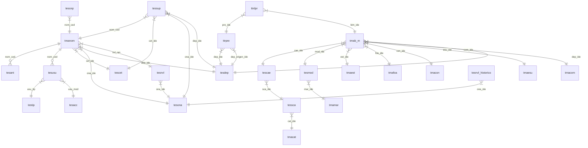

# Documentación de Base de Datos: dbsiget

## Tabla: tesant

*Descripción:* Almacena información sobre las antigüedades de los empleados.

| Columna      | Tipo         | Clave     | Nulo | Valor por defecto | Comentario                            |
|--------------|--------------|-----------|------|-------------------|----------------------------------------|
| ant_ide      | INT          | PK        | No   | AUTO_INCREMENT    | Identificador único de antigüedad      |
| ant_ani      | DATE         |           | No   |                   | Años de antigüedad inicial             |
| ant_anf      | DATE         |           | No   |                   | Años de antigüedad final               |
| nom_ced      | VARCHAR(10)  | FK        | No   |                   | Cédula del empleado                    |

*Relaciones:*
- nom_ced → FK hacia tmanom.nom_ced

---

## Tabla: tescae

*Descripción:* Almacena categorías específicas de bienes.

| Columna      | Tipo         | Clave     | Nulo | Valor por defecto | Comentario                            |
|--------------|--------------|-----------|------|-------------------|----------------------------------------|
| cae_ide      | INT          | PK        | No   |                   | Identificador de categoría específica  |
| cae_cae      | VARCHAR(100) |           | No   |                   | Descripción de categoría específica    |
| sca_ide      | INT          | FK        | No   |                   | Referencia a subcategoría en tessca    |

*Relaciones:*
- sca_ide → FK hacia tessca.sca_ide

---

## Tabla: tescet

*Descripción:* Almacena los cargos CET.

| Columna      | Tipo         | Clave     | Nulo | Valor por defecto | Comentario                            |
|--------------|--------------|-----------|------|-------------------|----------------------------------------|
| cet_ide      | INT          | PK        | No   | AUTO_INCREMENT    | Identificador único de cargo CET       |
| cet_car      | VARCHAR(50)  |           | No   |                   | Nombre del cargo CET                   |

---

## Tabla: tesded

*Descripción:* Almacena las deducciones aplicables.

| Columna      | Tipo         | Clave     | Nulo | Valor por defecto | Comentario                            |
|--------------|--------------|-----------|------|-------------------|----------------------------------------|
| ded_ide      | INT          | PK        | No   | AUTO_INCREMENT    | Identificador único de deducción       |
| ded_raz      | VARCHAR(100) |           | No   |                   | Razón de la deducción                  |
| ded_por      | DECIMAL(10,2)|           | No   |                   | Porcentaje de la deducción             |

---

## Tabla: tesdep

*Descripción:* Almacena los departamentos de la organización.

| Columna      | Tipo         | Clave     | Nulo | Valor por defecto | Comentario                            |
|--------------|--------------|-----------|------|-------------------|----------------------------------------|
| dep_ide      | INT          | PK        | No   | AUTO_INCREMENT    | Identificador único de departamento    |
| dep_nom      | VARCHAR(255) |           | No   |                   | Nombre del departamento               |
| dep_des      | TEXT         |           | Sí   | NULL              | Descripción del departamento          |

---

## Tabla: tesmod

*Descripción:* Almacena los modelos de bienes.

| Columna      | Tipo         | Clave     | Nulo | Valor por defecto | Comentario                            |
|--------------|--------------|-----------|------|-------------------|----------------------------------------|
| mod_ide      | VARCHAR(10)  | PK        | No   |                   | Identificador de modelo               |
| mod_mod      | VARCHAR(50)  |           | No   |                   | Descripción de modelo                 |
| mar_ide      | INT          | FK        | No   |                   | Referencia a marca en tmamar          |

*Relaciones:*
- mar_ide → FK hacia tmamar.mar_ide

---

## Tabla: tesona

*Descripción:* Almacena los cargos ONAPRE.

| Columna      | Tipo         | Clave     | Nulo | Valor por defecto | Comentario                            |
|--------------|--------------|-----------|------|-------------------|----------------------------------------|
| ona_ide      | INT          | PK        | No   | AUTO_INCREMENT    | Identificador único de cargo ONAPRE    |
| ona_car      | VARCHAR(50)  |           | No   |                   | Nombre del cargo ONAPRE                |

---

## Tabla: tesnvl

*Descripción:* Almacena los niveles salariales.

| Columna      | Tipo         | Clave     | Nulo | Valor por defecto | Comentario                            |
|--------------|--------------|-----------|------|-------------------|----------------------------------------|
| nvl_ide      | INT          | PK        | No   | AUTO_INCREMENT    | Identificador único del rango         |
| nvl_ran      | VARCHAR(5)   |           | No   |                   | Tipo de nivel salarial                |
| nvl_sal      | DECIMAL(10,2)|           | No   |                   | Salario correspondiente               |
| ona_ide      | INT          | FK        | Sí   | NULL              | Referencia a cargo ONAPRE en tesona   |

*Relaciones:*
- ona_ide → FK hacia tesona.ona_ide

---

## Tabla: tesnvl_historico

*Descripción:* Almacena el histórico de cambios en los niveles salariales.

| Columna      | Tipo         | Clave     | Nulo | Valor por defecto | Comentario                            |
|--------------|--------------|-----------|------|-------------------|----------------------------------------|
| nvl_ide      | INT          | PK        | No   | AUTO_INCREMENT    | Identificador único del rango         |
| nvl_ran      | VARCHAR(5)   |           | No   |                   | Tipo de nivel salarial                |
| nvl_sal      | DECIMAL(10,2)|           | No   |                   | Salario histórico                     |
| ona_ide      | INT          | FK        | Sí   | NULL              | Referencia a cargo ONAPRE en tesona   |
| nvl_fec      | DATE         |           | No   |                   | Fecha del salario histórico           |

*Relaciones:*
- ona_ide → FK hacia tesona.ona_ide

---

## Tabla: tespri

*Descripción:* Almacena las primas aplicables.

| Columna      | Tipo         | Clave     | Nulo | Valor por defecto | Comentario                            |
|--------------|--------------|-----------|------|-------------------|----------------------------------------|
| pri_ide      | INT          | PK        | No   | AUTO_INCREMENT    | Identificador único de prima          |
| pri_raz      | VARCHAR(100) |           | No   |                   | Razón de la prima                     |
| pri_por      | DECIMAL(5,2) |           | No   |                   | Porcentaje de la prima                |

---

## Tabla: tessca

*Descripción:* Almacena las subcategorías de bienes.

| Columna      | Tipo         | Clave     | Nulo | Valor por defecto | Comentario                            |
|--------------|--------------|-----------|------|-------------------|----------------------------------------|
| sca_ide      | INT          | PK        | No   |                   | Identificador de subcategoría         |
| sca_sca      | VARCHAR(100) |           | No   |                   | Descripción de subcategoría           |
| cat_ide      | INT          | FK        | No   |                   | Referencia a categoría en tmacat      |

*Relaciones:*
- cat_ide → FK hacia tmacat.cat_ide

---

## Tabla: tesusu

*Descripción:* Almacena los usuarios del sistema.

| Columna      | Tipo         | Clave     | Nulo | Valor por defecto | Comentario                            |
|--------------|--------------|-----------|------|-------------------|----------------------------------------|
| usu_ide      | VARCHAR(10)  | PK        | No   |                   | Identificador único del usuario       |
| usu_usu      | VARCHAR(10)  |           | No   |                   | Nickname del usuario                  |
| usu_con      | VARCHAR(255) |           | No   |                   | Contraseña del usuario (hashed)       |
| usu_nom      | VARCHAR(50)  |           | No   |                   | Nombres del usuario                   |
| usu_ape      | VARCHAR(50)  |           | No   |                   | Apellidos del usuario                 |
| usu_tip      | INT(1)       | FK        | No   |                   | Perfil o tipo de usuario              |
| usu_mod      | INT(2)       | FK        | No   |                   | Módulos de acceso                     |
| nom_ced      | VARCHAR(10)  | FK        | Sí   | NULL              | Cédula del empleado (referencia)      |

*Relaciones:*
- usu_tip → FK hacia testip.usu_tip
- usu_mod → FK hacia tesacc.usu_mod
- nom_ced → FK hacia tmanom.nom_ced

---

## Tabla: tmab_m

*Descripción:* Almacena los bienes muebles del sistema.

| Columna      | Tipo         | Clave     | Nulo | Valor por defecto | Comentario                            |
|--------------|--------------|-----------|------|-------------------|----------------------------------------|
| bim_ide      | VARCHAR(10)  | PK        | No   |                   | Código interno del bien               |
| bim_des      | TEXT         |           | No   |                   | Descripción del bien                  |
| bim_fec      | DATE         |           | No   |                   | Fecha de adquisición                  |
| bim_ndo      | VARCHAR(10)  |           | No   |                   | Número de documento (factura)         |
| bim_val      | DECIMAL(10,0)|           | No   |                   | Valor monetario de adquisición        |
| bim_moneda   | VARCHAR(10)  |           | No   |                   | Moneda (Bolívares)                    |
| bim_color    | VARCHAR(30)  |           | No   |                   | Color del bien                        |
| bim_cod      | VARCHAR(20)  |           | No   |                   | Código de SUDEBIN                     |
| bim_obs      | TEXT         |           | Sí   | NULL              | Observaciones                         |
| bim_sede     | VARCHAR(20)  |           | No   | PRINCIPAL         | Sede del bien                         |
| est_ide      | INT          | FK        | No   |                   | Estado del bien                       |
| foa_ide      | INT          | FK        | No   |                   | Forma de adquisición                  |
| con_ide      | INT          | FK        | No   |                   | Condición física                      |
| esu_ide      | INT          | FK        | No   |                   | Estado de uso                         |
| mod_ide      | VARCHAR(10)  | FK        | Sí   | NULL              | Modelo del bien                       |
| cae_ide      | INT          | FK        | Sí   | NULL              | Categoría específica                  |
| bim_inc      | TINYINT(1)   |           | Sí   | 1                 | Estado de incorporación (1=inc)       |
| bim_fed      | DATE         |           | Sí   | NULL              | Fecha de desincorporación             |
| com_ide      | INT          | FK        | Sí   | NULL              | Concepto de movimiento                |
| dep_ide      | INT          | FK        | Sí   | NULL              | Departamento del bien                 |

*Relaciones:*
- est_ide → FK hacia tmaest.est_ide
- foa_ide → FK hacia tmafoa.foa_ide
- con_ide → FK hacia tmacon.con_ide
- esu_ide → FK hacia tmaesu.esu_ide
- mod_ide → FK hacia tesmod.mod_ide
- cae_ide → FK hacia tescae.cae_ide
- com_ide → FK hacia tmacom.com_ide
- dep_ide → FK hacia tesdep.dep_ide

---

## Tabla: tmacat

*Descripción:* Almacena las categorías generales de bienes.

| Columna      | Tipo         | Clave     | Nulo | Valor por defecto | Comentario                            |
|--------------|--------------|-----------|------|-------------------|----------------------------------------|
| cat_ide      | INT          | PK        | No   |                   | Identificador de categoría            |
| cat_cat      | VARCHAR(100) |           | No   |                   | Descripción de categoría              |

---

## Tabla: tmacon

*Descripción:* Almacena las condiciones físicas de los bienes.

| Columna      | Tipo         | Clave     | Nulo | Valor por defecto | Comentario                            |
|--------------|--------------|-----------|------|-------------------|----------------------------------------|
| con_ide      | INT          | PK        | No   |                   | Identificador de condición            |
| con_con      | VARCHAR(50)  |           | No   |                   | Descripción de condición              |

---

## Tabla: tmaest

*Descripción:* Almacena los estados de los bienes.

| Columna      | Tipo         | Clave     | Nulo | Valor por defecto | Comentario                            |
|--------------|--------------|-----------|------|-------------------|----------------------------------------|
| est_ide      | INT          | PK        | No   |                   | Identificador de status               |
| est_est      | VARCHAR(50)  |           | No   |                   | Descripción de status                 |

---

## Tabla: tmaesu

*Descripción:* Almacena los estados de uso de los bienes.

| Columna      | Tipo         | Clave     | Nulo | Valor por defecto | Comentario                            |
|--------------|--------------|-----------|------|-------------------|----------------------------------------|
| esu_ide      | INT          | PK        | No   |                   | Identificador de estado de uso        |
| esu_esu      | VARCHAR(50)  |           | No   |                   | Descripción de estado de uso          |

---

## Tabla: tmafoa

*Descripción:* Almacena las formas de adquisición de bienes.

| Columna      | Tipo         | Clave     | Nulo | Valor por defecto | Comentario                            |
|--------------|--------------|-----------|------|-------------------|----------------------------------------|
| foa_ide      | INT          | PK        | No   |                   | Identificador de forma de adquisición |
| foa_nom      | VARCHAR(50)  |           | No   |                   | Descripción de forma de adquisición   |

---

## Tabla: tmamar

*Descripción:* Almacena las marcas de los bienes.

| Columna      | Tipo         | Clave     | Nulo | Valor por defecto | Comentario                            |
|--------------|--------------|-----------|------|-------------------|----------------------------------------|
| mar_ide      | INT          | PK        | No   | AUTO_INCREMENT    | Identificador único de marca          |
| mar_mar      | VARCHAR(100) |           | No   |                   | Descripción de la marca               |

---

## Tabla: tmanom

*Descripción:* Almacena la información de los empleados.

| Columna      | Tipo         | Clave     | Nulo | Valor por defecto | Comentario                            |
|--------------|--------------|-----------|------|-------------------|----------------------------------------|
| nom_ced      | VARCHAR(10)  | PK        | No   |                   | Cédula del empleado                   |
| nom_nom      | VARCHAR(50)  |           | No   |                   | Nombre del empleado                   |
| nom_ape      | VARCHAR(50)  |           | No   |                   | Apellido del empleado                 |
| nom_fec      | DATE         |           | No   |                   | Fecha de ingreso                      |
| nom_gen      | ENUM('M','F')|           | No   |                   | Género del empleado                   |
| nom_nhi      | INT          |           | No   |                   | Número de hijos                       |
| nom_pro      | INT(1)       |           | No   |                   | Valor de profesionalización           |
| cet_ide      | INT          | FK        | No   |                   | Cargo CET                             |
| ona_ide      | INT          | FK        | No   |                   | Cargo ONAPRE                          |
| nvl_ran      | VARCHAR(3)   |           | No   |                   | Tipo de nivel salarial                |
| dep_ide      | INT          | FK        | No   |                   | Departamento                          |

*Relaciones:*
- cet_ide → FK hacia tescet.cet_ide
- ona_ide → FK hacia tesona.ona_ide
- dep_ide → FK hacia tesdep.dep_ide

---

## Tabla: testip

*Descripción:* Almacena los tipos de usuarios del sistema.

| Columna      | Tipo         | Clave     | Nulo | Valor por defecto | Comentario                            |
|--------------|--------------|-----------|------|-------------------|----------------------------------------|
| usu_tip      | INT          | PK        | No   | AUTO_INCREMENT    | Identificador de tipos de usuario     |
| tip_nom      | VARCHAR(50)  |           | No   |                   | Nombre de usuario                     |

---

## Tabla: tesacc

*Descripción:* Almacena los tipos de acceso al sistema.

| Columna      | Tipo         | Clave     | Nulo | Valor por defecto | Comentario                            |
|--------------|--------------|-----------|------|-------------------|----------------------------------------|
| usu_mod      | INT          | PK        | No   | AUTO_INCREMENT    | Identificador de tipos de acceso      |
| acc_nom      | VARCHAR(50)  |           | No   |                   | Acceso al sistema                     |

---

## Tabla: tmacom

*Descripción:* Almacena los conceptos de movimiento de bienes.

| Columna      | Tipo         | Clave     | Nulo | Valor por defecto | Comentario                            |
|--------------|--------------|-----------|------|-------------------|----------------------------------------|
| com_ide      | INT          | PK        | No   |                   | Identificador de concepto             |
| com_com      | VARCHAR(50)  |           | No   |                   | Descripción de concepto               |

---

## Tabla: tessup

*Descripción:* Almacena información sobre suplencias de empleados.

| Columna      | Tipo         | Clave     | Nulo | Valor por defecto | Comentario                            |
|--------------|--------------|-----------|------|-------------------|----------------------------------------|
| sup_ide      | INT          | PK        | No   | AUTO_INCREMENT    | ID único de suplencia                 |
| nom_ced      | VARCHAR(10)  | FK        | No   |                   | Cédula del empleado suplente          |
| sup_fec_ini  | DATE         |           | No   |                   | Fecha de inicio                       |
| sup_fec_fin  | DATE         |           | Sí   | NULL              | Fecha de fin                          |
| cet_ide      | INT          | FK        | Sí   | NULL              | Cargo CET que suple                   |
| ona_ide      | INT          | FK        | Sí   | NULL              | Cargo ONAPRE que suple                |
| nvl_ran      | VARCHAR(3)   |           | Sí   | NULL              | Nivel salarial                        |
| dep_ide      | INT          | FK        | Sí   | NULL              | Departamento                          |
| sup_activa   | TINYINT(1)   |           | Sí   | 1                 | Indicador de suplencia activa         |

*Relaciones:*
- nom_ced → FK hacia tmanom.nom_ced
- cet_ide → FK hacia tescet.cet_ide
- ona_ide → FK hacia tesona.ona_ide
- dep_ide → FK hacia tesdep.dep_ide

---

## Tabla: tescep

*Descripción:* Almacena información sobre cajas de ahorro de empleados.

| Columna      | Tipo         | Clave     | Nulo | Valor por defecto | Comentario                            |
|--------------|--------------|-----------|------|-------------------|----------------------------------------|
| cep_ide      | INT          | PK        | No   | AUTO_INCREMENT    | ID único de caja de ahorro            |
| cep_activa   | TINYINT(1)   |           | Sí   | 1                 | Indicador de caja activa              |
| nom_ced      | VARCHAR(10)  | FK        | No   |                   | Cédula del empleado                   |

*Relaciones:*
- nom_ced → FK hacia tmanom.nom_ced

---

## Tabla: ttrpre

*Descripción:* Almacena información sobre préstamos de bienes.

| Columna      | Tipo         | Clave     | Nulo | Valor por defecto | Comentario                            |
|--------------|--------------|-----------|------|-------------------|----------------------------------------|
| pre_ide      | INT          | PK        | No   | AUTO_INCREMENT    | ID único de préstamo                  |
| pre_fec      | DATE         |           | No   |                   | Fecha del préstamo                    |
| pre_ndo      | VARCHAR(50)  | UNIQUE    | No   |                   | Número de documento (oficio)          |
| dep_ide      | INT          | FK        | No   |                   | Departamento destino                  |
| pre_est      | TINYINT      |           | No   | 1                 | Estatus (1=activo, 0=inactivo)        |
| dep_origen_ide| INT         | FK        | No   |                   | Departamento origen                   |

*Relaciones:*
- dep_ide → FK hacia tesdep.dep_ide
- dep_origen_ide → FK hacia tesdep.dep_ide

---

## Tabla: ttrdpr

*Descripción:* Almacena el detalle de los préstamos de bienes.

| Columna      | Tipo         | Clave     | Nulo | Valor por defecto | Comentario                            |
|--------------|--------------|-----------|------|-------------------|----------------------------------------|
| dpr_ide      | INT          | PK        | No   | AUTO_INCREMENT    | ID único de detalle                   |
| pre_ide      | INT          | FK        | No   |                   | ID del préstamo                       |
| bim_ide      | VARCHAR(10)  | FK        | No   |                   | ID del bien prestado                  |
| dpr_est      | TINYINT      |           | No   | 1                 | Estatus del bien en préstamo          |

*Relaciones:*
- pre_ide → FK hacia ttrpre.pre_ide
- bim_ide → FK hacia tmab_m.bim_ide

---

## Tabla: bit_usu

*Descripción:* Registra cambios en la tabla de usuarios (tesusu).

| Columna                   | Tipo         | Clave     | Nulo | Valor por defecto | Comentario                            |
|---------------------------|--------------|-----------|------|-------------------|----------------------------------------|
| bit_id                    | INT          | PK        | No   | AUTO_INCREMENT    | ID único del registro de bitácora      |
| bit_tabla                 | VARCHAR(50)  |           | No   |                   | Nombre de la tabla auditada            |
| bit_operacion             | ENUM('INSERT','UPDATE','DELETE') | No |      | Tipo de operación registrada         |
| bit_usu_ide               | VARCHAR(10)  |           | Sí   | NULL              | ID de usuario afectado                 |
| bit_usu_usu               | VARCHAR(10)  |           | No   |                   | Nickname del usuario afectado          |
| bit_usuario_responsable   | VARCHAR(10)  |           | No   |                   | Usuario que realizó el cambio          |
| bit_detalles              | JSON         |           | Sí   | NULL              | Detalles de cambios en formato JSON    |
| bit_fecha                 | TIMESTAMP    |           | No   | CURRENT_TIMESTAMP | Fecha y hora del cambio                |

---

## Tabla: bit_nom

*Descripción:* Registra cambios en la tabla de empleados (tmanom).

| Columna                   | Tipo         | Clave     | Nulo | Valor por defecto | Comentario                            |
|---------------------------|--------------|-----------|------|-------------------|----------------------------------------|
| bit_id                    | INT          | PK        | No   | AUTO_INCREMENT    | ID único del registro                 |
| bit_tabla                 | VARCHAR(50)  |           | No   |                   | Siempre 'tmanom'                       |
| bit_operacion             | ENUM('INSERT','UPDATE','DELETE') | No |      | Tipo de operación                 |
| bit_nom_ced               | VARCHAR(10)  |           | Sí   | NULL              | Cédula del empleado afectado           |
| bit_usuario_responsable   | VARCHAR(10)  |           | No   |                   | Usuario que realizó el cambio          |
| bit_detalles              | JSON         |           | Sí   | NULL              | Campos modificados en JSON             |
| bit_fecha                 | TIMESTAMP    |           | No   | CURRENT_TIMESTAMP | Fecha del cambio                       |

---

## Tabla: bit_nvl

*Descripción:* Registra cambios en niveles salariales (tesnvl).

| Columna                   | Tipo         | Clave     | Nulo | Valor por defecto | Comentario                            |
|---------------------------|--------------|-----------|------|-------------------|----------------------------------------|
| bit_id                    | INT          | PK        | No   | AUTO_INCREMENT    | ID único del registro                 |
| bit_tabla                 | VARCHAR(50)  |           | No   |                   | Siempre 'tesnvl'                       |
| bit_operacion             | ENUM('UPDATE','DELETE') | No |      | Operaciones permitidas          |
| bit_nvl_ide               | INT          |           | Sí   | NULL              | ID de nivel afectado                   |
| bit_usuario_responsable   | VARCHAR(10)  |           | No   |                   | Usuario que realizó el cambio          |
| bit_detalles              | JSON         |           | Sí   | NULL              | Datos antiguos/nuevos                  |
| bit_fecha                 | TIMESTAMP    |           | No   | CURRENT_TIMESTAMP | Fecha del cambio                       |

*Relaciones:*
- bit_nvl_ide → Referencia a tesnvl.nvl_ide

---

## Vista: vw_bienes_muebles

*Descripción:* Vista completa de bienes muebles incorporados con información relacionada.

| Columna origen            | Tabla origen | Tipo         | Descripción                                |
|---------------------------|--------------|--------------|--------------------------------------------|
| bim_ide                   | tmab_m       | VARCHAR(10)  | Código interno del bien                    |
| bim_des                   | tmab_m       | TEXT         | Descripción detallada                      |
| bim_fec                   | tmab_m       | DATE         | Fecha de adquisición                       |
| bim_ndo                   | tmab_m       | VARCHAR(10)  | Número de documento                        |
| bim_val                   | tmab_m       | DECIMAL(10,0)| Valor monetario                            |
| bim_moneda                | tmab_m       | VARCHAR(10)  | Moneda (siempre "Bolívares")               |
| bim_color                 | tmab_m       | VARCHAR(30)  | Color del bien                             |
| bim_cod                   | tmab_m       | VARCHAR(20)  | Código SUDEBIN                             |
| bim_sede                  | tmab_m       | VARCHAR(20)  | Sede física                                |
| forma_adquisicion         | tmafoa       | VARCHAR(50)  | Nombre de la forma de adquisición          |
| condicion                 | tmacon       | VARCHAR(50)  | Estado físico del bien                     |
| estado_uso                | tmaesu       | VARCHAR(50)  | Descripción del estado de uso              |
| marca                     | tmamar       | VARCHAR(100) | Nombre de la marca                         |
| modelo                    | tesmod       | VARCHAR(50)  | Nombre del modelo                          |
| categoria_general         | tmacat       | VARCHAR(100) | Categoría de nivel superior                |
| subcategoria              | tessca       | VARCHAR(100) | Subclasificación del bien                  |
| categoria_especifica      | tescae       | VARCHAR(100) | Clasificación detallada                    |
| departamento              | tesdep       | VARCHAR(255) | Departamento asignado                      |

*Filtro:* Solo incluye bienes con bim_inc = 1 (incorporados)

---

## Vista: vw_bienes_muebles_bm1

*Descripción:* Vista optimizada para reporte BM1.

| Columna origen            | Tabla origen | Tipo         | Descripción                                |
|---------------------------|--------------|--------------|--------------------------------------------|
| bim_ide                   | tmab_m       | VARCHAR(10)  | Identificador del bien                     |
| bim_des                   | tmab_m       | TEXT         | Descripción abreviada                      |
| bim_val                   | tmab_m       | DECIMAL(10,0)| Valor en bolívares                         |
| categoria_general         | tmacat       | INT          | ID de categoría general                    |
| subcategoria              | tessca       | INT          | ID de subcategoría                         |
| categoria_especifica      | tescae       | INT          | ID de categoría específica                 |

*Filtro:* Solo incluye bienes incorporados (bim_inc = 1)
*Optimización:* Campos mínimos necesarios para el reporte BM1

---

## Diagrama de Relaciones


---

## Triggers (Disparadores)

*Propósito:* Los triggers automatizan procesos críticos y mantienen la integridad de los datos mediante acciones que se ejecutan ante eventos específicos.

*Tablas afectadas:* Todas las tablas de bitácoras contienen disparadores que realizan los inserts cuando existen modificaciones reales dentro de la base de datos (aplicables siempre para: Insert, update o delete).

### Estructura General
Todos los triggers siguen este patrón básico:
```sql
CREATE TRIGGER [nombre]
[BEFORE/AFTER] [INSERT/UPDATE/DELETE] ON [tabla]
FOR EACH ROW
BEGIN
    -- Lógica del trigger
END